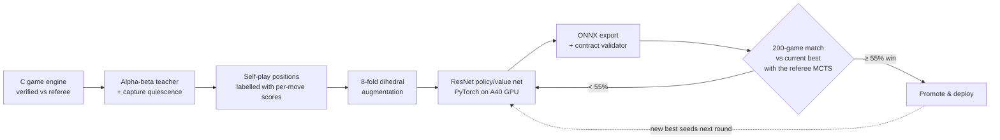
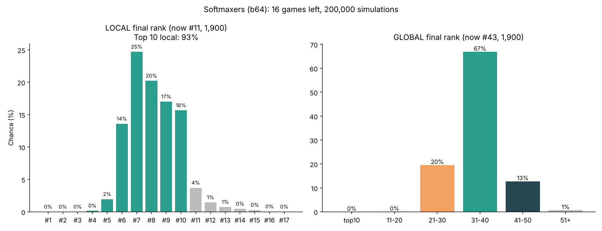

# CCC 2026 · Data & AI: *Colony: One* (Level 4 Tournament)

_Cloudflight Coding Contest_

**Team Softmaxers**: **#14 local place** at **CREIC Cluj-Napoca**, 42nd Cloudflight Coding Contest (CCC), Data & AI edition, 23 October 2026.

Level 4 of the contest was a live AI tournament. Every team uploaded an **ONNX neural network** that played the strategy board game *Colony: One* against every other team's network, with ratings computed by **Glicko-2**. We replaced a hand-written evaluation function with a **trained AlphaZero-style policy/value network**, then kept improving it during the contest with a GPU training loop that only promoted verified winners.

| | Result |
|---|---|
| **Final local rank** | **#14** (CREIC Cluj-Napoca) |
| Peak local rank | **#8** (19:31) |
| Global rank | **#147 → peak #39** of ~300 registered models |
| Arena rating | **1,435 → peak 2,009** (Glicko-2) |
| Best arena run | **83% win rate over 30 games** (model `b64`) |
| Strongest verified model | `it1`, 1.16M params, beat the previous best in 113 of 200 games |

---

## The game

*Colony: One* is a two-player game (Cyan vs Magenta) on an 8×8 board with six piece types, including a **Kernel** (the king-like piece), **bodyguards**, a **firewall** mechanic and a "bare-kernel" endgame. Every move is either a 1–3 square step in one of 8 directions or a knight jump, so the full action space is 64 × 64 = **4,096 from→to moves**.

The tournament referee does **not** let the model choose moves directly. It runs **Monte Carlo Tree Search (100 simulations per move)** and queries the model for:


_(Monte Carlo Tree Search - Source: GeeksforGeeks)_

- `policy`: 4,096 raw logits (which moves to explore first)
- `value`: one number in [−1, 1] (who is winning)

A better network therefore means a smarter search. That's the only thing teams compete on.

**Submission contract:** input `observation` (batch, 16, 8, 8) float32 · ONNX opset 13–18 · ≤ 5 MiB · dynamic batch · allow-listed operators only (no `Constant` nodes).

---

## Approach



1. **Teacher:** a fast C reimplementation of the game rules (verified move-for-move against the official engine) runs **alpha-beta search with capture quiescence** to score every legal move of a position.
2. **Data:** ~**542,000 labelled positions** (734 shards) from self-play, labelled first with 2 extra moves of lookahead, then 4 for deeper labels.
3. **Distillation targets:**
   - policy = `softmax(move_score / 0.5)`
   - value = `0.7 · tanh(best_score / 4) + 0.3 · game_outcome`
4. **Augmentation:** the rules are symmetric under the 8 rotations and reflections of the board, so every position is used in all 8 orientations.
5. **Gating:** a model is promoted only after winning a **200-game match** against the current best, using the same 100-simulation MCTS referee as the arena.
6. **Continuous improvement loop:** during the contest a background loop on a RunPod A40 GPU kept generating deeper-labelled data, fine-tuning from the current best, and gating every new model.

(Yes, we actually rented GPUs for this competition lol, proven extremely useful and helped us reach ~#43 global from previous ~#190 due to the sheer speed the extra compute added and due to the more complex model used)


_(Runpod please sponsor us 🙏)_

---

## Model architecture

AlphaZero-style residual CNN with a **move-offset policy head** ([`model/colony_model.py`](model/colony_model.py)):

_(Source: The New Yorker)_

```
observation (B,16,8,8)
  └─ Stem: Conv3×3 16→c · BN · ReLU
  └─ Trunk: 6 × ResidualBlock(c)          [Conv3×3·BN·ReLU·Conv3×3·BN + skip · ReLU]
       ├─ Policy head: Conv3×3 c→c · BN · ReLU · Conv1×1 c→32
       │     → 32 move-offset planes × 64 squares → fixed gather → (B, 4096) logits
       └─ Value head:  Conv1×1 c→8 · BN · ReLU · Linear 512→128 · ReLU · Linear 128→1 · tanh
```

**Key design choice:** every legal move lies on one of **32 offsets** (8 directions × lengths 1–3, plus 8 knight jumps). The policy head predicts one plane per offset, and a precomputed index table maps those 2,048 values onto the 4,096 from→to slots. The movement geometry is built into the network instead of being learned.

| Model | Channels × blocks | Parameters | ONNX size |
|---|---|---|---|
| `b64` | 64 × 6 | 558,641 | 2.2 MB |
| `c96` / `it1` | 96 × 6 | 1,164,465 | 4.5 MB |

More detail: [`docs/ARCHITECTURE.md`](docs/ARCHITECTURE.md).

---

## Results

### Model ladder (internal 200-game matches, referee MCTS, colors alternated)

| Challenger | vs | Challenger wins | ≈ Elo |
|---|---|---|---|
| `a64` (first trained net) | hand-written evaluator (deployed) | **172 / 200 (86.0%)** | +315 |
| `a96` (first wide net) | hand-written evaluator | **172 / 200 (86.0%)** | +315 |
| `b64` (all data, 64×6) | `a64` | **133 / 200 (66.5%)** | +119 |
| `b64` | hand-written evaluator | **181 / 200 (90.5%)** | +392 |
| `c96` (96×6) | `b64` | **122 / 200 (61.0%)** | +78 |
| `d96` (c96 fine-tune) | `c96` | 96 / 200 (48.0%) | −14 → rejected |
| `it1` (c96 + deeper data) | `c96` | **113 / 200 (56.5%)** | +45 → promoted |
| `it2`, `it3` | `it1` | 51.0%, 53.0% | below the 55% gate → rejected |

Full table with per-color splits: [`results/model_evaluations.csv`](results/model_evaluations.csv).

### Live arena

- `b64` went from rating **1,435 → 1,900+** and global **#134 → #43**, winning **25 of its first 30 games (83%)**, evenly split between cyan and magenta.
- Peak: **2,009 rating** and **local #8**.
- In the last 15 minutes, late model swaps (`b64` re-upload → `a96` → `it1` → `a96`) were amplified by Glicko-2's uncertainty reset: **+100** after one upload, **−120** after another. The final result was **local #14, global #43**.

### Live rank forecasting

During the contest I ran Monte-Carlo simulations (200k runs) of our remaining games to decide when to swap models. Here's the scenario analysis at 19:39 (code: [`analysis/simulate_final_rank.py`](analysis/simulate_final_rank.py)):



---

## What I learned

- **Distilling a search teacher works fast:** a 559k-parameter network trained for ~7 minutes beat a carefully hand-written evaluator **90% of the time**.
- **Data quality mattered more than model size.** Going to 96 channels gave +78 Elo. Deeper teacher labels gave a further +45 on top.
- **Gate everything.** Two of the five fine-tuned candidates were no better than their parent. Without 200-game gating they would have been shipped.
- **Understand the rating system.** In Glicko-2, a new upload resets rating uncertainty, so each later game moves the score much more. That's useful when you're behind, and dangerous when you're defending a position. **Lock in the strongest model early.** See [`docs/LESSONS.md`](docs/LESSONS.md).

Contest timeline: [`docs/TIMELINE.md`](docs/TIMELINE.md).

---

## Repository layout

```
models/                         # The actual submitted ONNX models (b64, a96, it1, hand-written baseline)
model/colony_model.py          # Network definition (PyTorch), identical to the one used in the contest
analysis/simulate_final_rank.py # Monte-Carlo rank forecasting used live during the tournament
results/model_evaluations.csv   # All internal head-to-head match results
assets/                         # Forecast charts generated during the contest
docs/ARCHITECTURE.md            # Network, training targets and pipeline in detail
docs/TIMELINE.md                # What happened, minute by minute
docs/LESSONS.md                 # Takeaways on training, gating and rating systems
```

**Not included:** the official contest level files (CCC property), the C engine and data generators from the contest machine (left on the terminated GPU pod), the ~540k-position dataset. See [`models/README.md`](models/README.md) for what each saved model is.

## Running the model code

```bash
pip install -r requirements.txt
python model/colony_model.py           # builds b64 / c96, prints parameter counts and output shapes
python analysis/simulate_final_rank.py # reproduces the rank-forecast charts
```

## Tools

Python · PyTorch · ONNX / ONNX Runtime · NumPy · Matplotlib · C (game engine) · RunPod (NVIDIA A40) · JupyterLab. Claude Opus 5.5 on Max was used as an AI pair-programmer during the contest (vibe-coding was a huge advantage and the majority of teams had at least one member using generative ai tools either to guide the model engineering process or to `outrageously` nuclear-prompt agents into delivering final solutions without understanding the process of obtaining those; frankly we did a bit of both, and I think this was the best combination between having fun, learning something new, and being competitive on the leaderboard :)

## License

MIT, see [LICENSE](LICENSE). *Colony: One* and the contest materials belong to Cloudflight / CCC.
